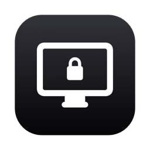
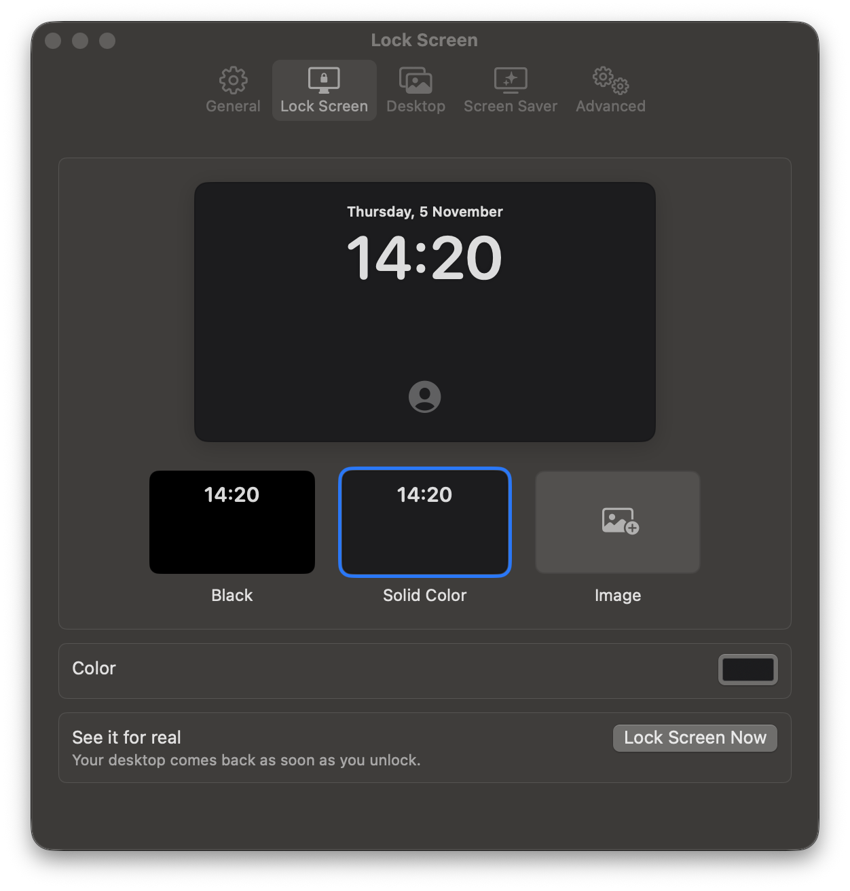
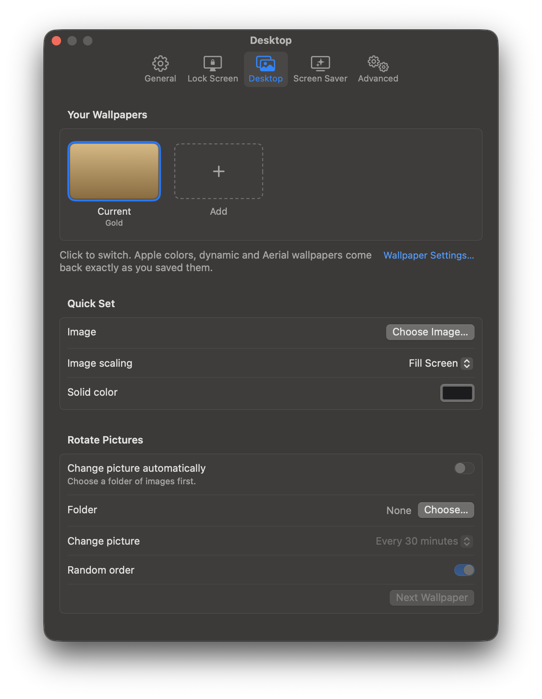
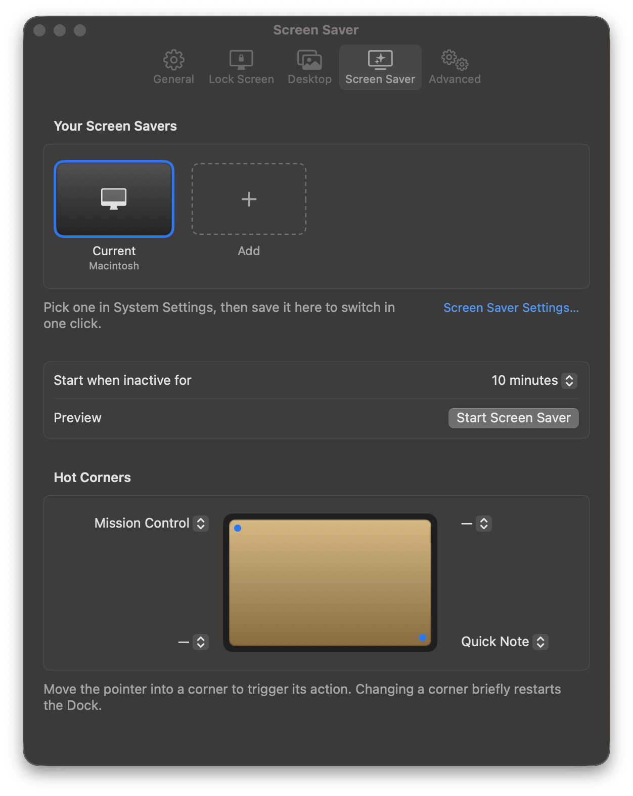

<p align="center">
  
</p>

<h1 align="center">LockWall</h1>

<p align="center">
  <b>A separate lock screen wallpaper for your Mac — plus your desktop wallpaper, screen saver and hot corners, all from the menu bar.</b><br>
  Native SwiftUI · ~16 MB idle · macOS 15+ · Free and open source
</p>

<p align="center">
  
</p>

## Why

I got tired of opening System Settings every time I wanted to change something about my wallpaper — and macOS doesn't even let you give the lock screen its own wallpaper. Since Sonoma, the lock screen simply shows whatever your desktop shows.

So I made LockWall: a small menu bar app that handles all of my wallpaper configuration in one place, so I never have to open System Settings for it again.

## Features

### 🔒 A lock screen wallpaper of its own

The headline feature, and something macOS can't do on its own.

- Pick **Black**, any **solid color**, or **any image** for the lock screen — your desktop stays untouched.
- Live preview with the clock, just like the real lock screen.
- Image scaling: Fill, Fit, Stretch or Center, with a background color.
- **Lock Screen Now** to see it for real; your desktop is back the moment you unlock.
- Drag an image onto the preview to use it.

### 🖼 Desktop wallpaper in one click



- **Save any Apple wallpaper** — colors with their gradients, dynamic and Aerial wallpapers — and switch back to it exactly, from the menu bar.
- Set an image or solid color instantly, with scaling options.
- **Rotate pictures** from a folder on a schedule (paused while locked, so your lock screen stays put).
- Recent wallpapers, one click away.

<br clear="right">

### ✨ Screen saver and hot corners



- Save screen savers and switch between them.
- Set when the screen saver starts, or start it right now.
- Configure all four **hot corners** on a picture of your screen.

<br clear="right">

### 🍎 Feels like part of macOS

- Lives in the menu bar; no Dock icon.
- Standard macOS Settings window with toolbar tabs, built with SwiftUI.
- Open at login, hide the menu bar icon (open the app again to reach Settings), a one-screen welcome.
- No network access, no analytics, no account.

### 🪶 Lightweight

LockWall sits in the background all day, so it's built to cost next to nothing:

| | Idle | Settings open | After closing Settings |
|---|---|---|---|
| Memory | ~16 MB | ~40 MB | ~37 MB |
| CPU | 0% | ≤0.3% | 0% |
| Wakeups | 0 per minute | ~3 per minute | ~3 per minute |

- No polling: it only wakes when your Mac locks or unlocks, or when a rotation is due.
- Images are never loaded at full size — previews are downsampled, so a 5K wallpaper costs the same as a small one.
- The Settings window is created when you open it and freed when you close it.

<sub>Measured on macOS 27 (M4 Pro) with `footprint` and `top` over 60-second samples.</sub>

## Install

LockWall is built from source (it isn't notarized yet). You need macOS 15 or later and Xcode 16 or later (or the Swift 6 command line tools).

```sh
git clone https://github.com/khapham7165/LockWall.git
cd LockWall
./build.sh install   # builds, copies to /Applications and launches
```

`./build.sh` alone builds `build/LockWall.app` without installing.

## How it works

macOS draws the lock screen from the live desktop wallpaper, so LockWall swaps it:

1. **On lock**, it saves your current wallpaper setup and sets the lock wallpaper.
2. **On unlock**, it writes your saved setup back and restarts the system wallpaper service so it reloads.
3. It then checks that your wallpaper actually came back, and retries if it didn't.

Saved Apple wallpapers and screen savers work the same way: LockWall keeps an exact copy of the system's own configuration and writes it back when you pick it, so nothing is approximated.

> [!NOTE]
> This relies on undocumented macOS internals: the wallpaper store at `~/Library/Application Support/com.apple.wallpaper/Store/Index.plist` and the private `SACLockScreenImmediate` call for **Lock Screen Now**. It's tested on macOS 27, and a future macOS update could break it. If your desktop ever stays on the lock wallpaper, use **Settings → Advanced → Restore Now**.

## Files

| Path | What's there |
|---|---|
| `~/Library/Application Support/LockWall/` | Saved wallpapers, lock images, your saved desktop setup |
| `~/Library/Logs/LockWall.log` | Activity log (also shown in Settings → Advanced) |

## Uninstall

Quit LockWall from its menu (it restores your desktop wallpaper on quit), then:

```sh
rm -rf /Applications/LockWall.app ~/Library/Application\ Support/LockWall ~/Library/Logs/LockWall.log
defaults delete com.calix.lockwall
```

## License

[MIT](LICENSE)
